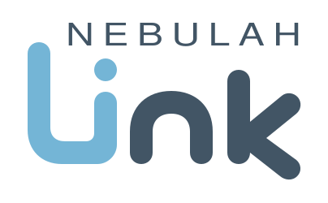

# Nebulah Link Basic

<picture>
  <source media="(prefers-color-scheme: dark)" srcset="dist/brand/logo-dark.svg">
  
</picture>

[Product website](https://link.nebulah.app/) | [Try the sample workspace](https://link.nebulah.app/demo) | [User guide](docs/USER_GUIDE.md) | [Release boundaries](docs/REPOSITORY_POLICY.md)

Nebulah Link brings your Xbox 360 into a browser on your Windows PC. It connects through your installed Xbox 360 Neighborhood. A phone on the same trusted network can view live console status through the PC.

This is an early-access build. Console compatibility has been checked on a limited setup; more hardware testing is needed before a stable release.

## Start on Windows

1. Install Xbox 360 Neighborhood and confirm it can connect to your console.
2. Download the [Basic source ZIP](https://github.com/Nebulah360/Nebulah-Link/archive/refs/heads/main.zip) or clone this repository, then extract the **whole** folder. The source checkout needs the USB engine build step below. A source ZIP is not a signed installer.
3. Double-click **Start Nebulah Link.cmd**. The launcher needs Python 3.10 or newer; it can offer to install Python through WinGet if needed.
4. Keep the bridge window open. In the browser, connect using Neighborhood's default console or enter your console's private IP address.

Nebulah Link does not include Xbox SDK files, console binaries, or games.

## What Basic can do

Basic covers work a stranger could do with an upstream tool plus Xbox 360 Neighborhood. Game Editors and Title editors stay in Nebulah Link Pro.

- Connect, status, the current title, temperatures, and loaded modules.
- Storage browse and download, capacity, and health. Individual file downloads remain capped at 128 MiB.
- A PC FTP proxy for Neighborhood-class file access, plus file upload and folder transfer, with the same safety caps as other bridge transfers.
- Inspected title launch.
- Power warm reboot, cold reboot, and shutdown.
- Screen capture.
- Bounded controller digital pulses through Companion. Guide, analog, and hold stay off. Companion is a capability module for pulses and managed plugin load, not an editor.
- Generic plugin load. Direct unload and force-release stay paused until a console trial passes. Plugin install is not available.
- DashLaunch `launch.ini` discover, session switch, and plugin-slot save with confirmation and read-back.
- Console XNotify.
- Library scan, favorites, shortcuts, and add-on listing.
- Title-update header inspect only.
- Content placement preview.
- IGDB Discover.
- Discord presence.
- BadBuilder USB from the PC-only USB Builder tab. The selected physical USB disk is erased only after exact disk confirmation and Windows elevation.
- Local ISO header inspect.
- Theme and launcher settings on the PC.
- Phone status view.
- CPU-key reveal with consent. Each read needs fresh confirmation.
- Hash and baseline check. A matching hash does not prove that a file is safe or compatible, and this check is not an editor recipe.
- Profile package inspect (read only).
- Cherry, the PC-local virtual profile.

Game Editors and Title editors stay in Nebulah Link Pro. That includes the Nebulah Editors XEX, in-title menus, bridge RTE hubs, editor recipes, profile-write apply, and gamertag or identity writes.

The current Stream360 stack is not shipped. It needs a Nebulah rewrite before any edition ships it. This page does not classify that code as Basic or Pro.

## USB Builder on Windows

The USB Builder uses BadBuilder v2.1.0 under its BSD 3-Clause license. Its source and license are in `vendor/BadBuilder`. The repository does not contain a compiled engine. Run `powershell -ExecutionPolicy Bypass -File tools/build_badbuilder.ps1` once with the .NET 10 SDK installed. Open the USB Builder tab to choose a currently connected USB disk, review the options, and type its exact `ERASE DISK N` confirmation. Downloads and extraction complete before formatting begins. The elevated engine rechecks disk identity and safety before any erase. No physical USB format/install has been hardware-tested through this Basic web route yet.

## Linux and macOS support

Install Python 3.10 or newer and run `bash start-local.sh` from this folder. Enter the console's private IP under **Connect console**, or save it as the default in **Settings**. Direct XBDM on TCP port 730 provides live status, storage browsing, file download and upload, inspected launch, power, notify, and PC screen capture. Plugin load, controller pulses, and launch.ini still need Windows Neighborhood. The Linux path has been checked for the earlier read operations only. One Ubuntu VM connected through direct XBDM, discovered ten roots, browsed 74 HDD entries, refreshed status, and captured a screen. More Linux hardware setups remain to be tested.

## View status on your phone

Use the LAN address printed by the bridge, then enter the Phone PIN shown in the PC browser. The phone view is limited to status. Console files and private console information are accessible only from the bridge PC. If Windows Firewall blocks the phone, run **Allow Phone Through Firewall.cmd** on the PC.

The local phone connection uses unencrypted HTTP. Use a trusted private network and do not forward the bridge port to the internet.

If you already have a PEM certificate and key trusted by your clients, start with `--tls-cert <certificate.pem> --tls-key <private-key.pem>` for optional HTTPS on both PC and phone URLs. Keep the private key outside this repository. Physical-phone HTTPS testing remains open.

## Keep your data when updating

The `.local` folder beside the launcher holds saved settings and library data. Keep that folder when replacing the app files with a newer version.

For a new folder, stop both copies of Basic. Run `python tools/migrate-local.py <old-basic-folder> <new-basic-folder>` to preview, then add `--apply` to copy only missing saved files. Existing destination files stay in place. Keep the old folder for rollback; do not use this between Basic and Pro.

For help, include the displayed support code and what you were doing. Do not share private console information.

[Website](https://link.nebulah.app/) · [Discord](https://discord.gg/QCQcXaz6RU) · [Report an issue](https://github.com/Nebulah360/Nebulah-Link/issues)


## The refreshed workspace

The approved Linkline identity now appears in the app header, browser icon, and Discord preview. The workspace groups Storage, Library, Discover, Console, USB builder, and Settings beside the active panel on desktop and in a compact navigation grid on smaller screens. Keyboard users can skip directly to the workspace; the active tool is exposed to assistive technology.

New browsers start in Nebulah blue. Existing saved accent colors remain intact. The USB Builder shares the app's byte formatter so its script can load alongside the main app without a global declaration conflict.

These are interface and source-maintenance changes. They do not grant new console capabilities, remove safety gates, or establish new hardware acceptance.

## Source validation

```text
python -m unittest discover -s tests -v
node --test tests/app_shell.test.cjs tests/console_actions.test.cjs
node --check dist/app.js
python -m compileall -q bridge tools
```

For browser checks, use a host installation of Playwright and set `NEBULAH_PLAYWRIGHT_MODULE` to its module path, then run `node --test tests/app_browser.test.cjs`. The test serves the real app files and intercepts API calls with disposable fixtures; no console, USB disk, or customer account is used. No production dependency is added.

See [the source review](docs/WORKSPACE_REFRESH.md) for provenance and validation limits. Public source follows the Legacy model: a reviewed snapshot, not a copy of private development history.
